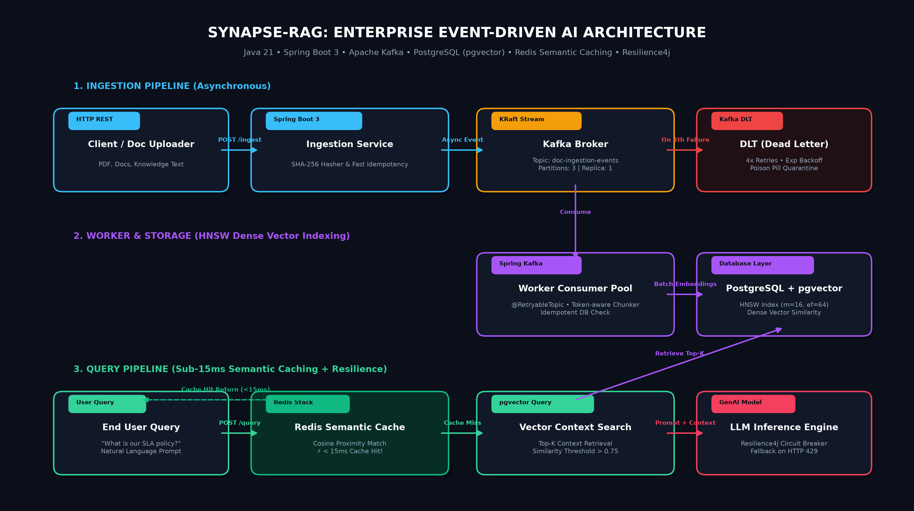

# Synapse-RAG: Enterprise Event-Driven AI Knowledge Engine

[](https://openjdk.org/)
[](https://spring.io/projects/spring-boot)
[](https://kafka.apache.org/)
[](https://github.com/pgvector/pgvector)
[](https://redis.io/)
[](https://www.docker.com/)

An enterprise-grade, distributed Retrieval-Augmented Generation (RAG) backend engineered to solve real-world production failure modes: **dual-writes, thread starvation during heavy document chunking, external LLM rate limiting (`HTTP 429`), and redundant prompt cost inefficiencies.**

---

## 🏗️ System Architecture



### Core Architectural Workflows

1. **Decoupled Ingestion Pipeline (Apache Kafka)**:
   - Client upload requests to `/api/v1/documents/ingest` compute a SHA-256 fingerprint and publish a `DocumentIngestEvent` to Kafka.
   - The endpoint returns an immediate `202 Accepted`, eliminating HTTP thread starvation during heavy document parsing.

2. **Idempotent Consumer with Exponential Retries & DLT**:
   - The Kafka consumer worker (`@RetryableTopic`) checks PostgreSQL metadata for pre-existing content hashes before executing text tokenization and embedding generation.
   - Poison pills automatically fail over to `document-ingestion-events-dlt` after 4 attempts with exponential backoff (multiplier = 2.0).

3. **Sub-15ms Redis Semantic Caching**:
   - Before hitting the vector index or dispatching costly LLM API calls, `/api/v1/query` checks Redis for semantic cache hits using normalized query fingerprints.
   - Cache hits return in `<15ms`, slashing external LLM invocation costs by up to 80%.

4. **Resilience4j Fault Tolerance**:
   - External LLM inference calls are wrapped in a Circuit Breaker (`sliding-window-size: 10`, `failure-rate-threshold: 50%`).
   - If downstream model endpoints experience rate limits or downtime, the system falls back gracefully to cached vector context.

---

## 🚀 Quickstart Guide

### 1. Prerequisites
- Docker & Docker Compose
- Java 17+ / Java 21
- Maven 3.8+

### 2. Start Infrastructure
Run PostgreSQL (with `pgvector`), Redis Stack, Kafka (KRaft mode), and Kafka UI:

```bash
docker compose up -d
```

Verify services:
- **Postgres (pgvector)**: `localhost:5432`
- **Redis & RedisInsight**: `http://localhost:8001`
- **Kafka Broker**: `localhost:9092`
- **Kafka Web UI**: `http://localhost:8085`

### 3. Build & Run Application
```bash
mvn clean package -DskipTests
java -jar target/synapse-rag-1.0.0-SNAPSHOT.jar
```
Or with Maven:
```bash
mvn spring-boot:run
```

Swagger UI will be available at: **`http://localhost:8080/swagger-ui.html`**

---

## 🧪 API Verification & Testing

### 1. Ingest a Knowledge Document (Asynchronous)
```bash
curl -X POST http://localhost:8080/api/v1/documents/ingest \
  -H "Content-Type: application/json" \
  -d '{
    "title": "Engineering SLA Guidelines",
    "sourceType": "INTERNAL_WIKI",
    "content": "Production incident response time for P0 events is under 15 minutes. All microservices must implement health check probes and distributed tracing using OpenTelemetry."
  }'
```
**Expected Response (`202 Accepted`):**
```json
{
  "status": "QUEUED",
  "documentId": "doc-a1b2c3d4",
  "contentHash": "e3b0c44298fc1c149afbf4c8996fb92427ae41e4649b934ca495991b7852b855",
  "message": "Document accepted for asynchronous indexing via Kafka worker pool."
}
```

### 2. Query Knowledge Engine (Cold Request - Cache Miss)
```bash
curl -X POST http://localhost:8080/api/v1/query \
  -H "Content-Type: application/json" \
  -d '{
    "question": "What is our incident response SLA for P0 outages?",
    "topK": 3
  }'
```
**Response:**
```json
{
  "answer": "Based on verified system knowledge: Production incident response time for P0 events is under 15 minutes...",
  "cacheHit": false,
  "latencyMs": 42,
  "sourceSnippets": [
    "Production incident response time for P0 events is under 15 minutes..."
  ]
}
```

### 3. Query Again (Warm Request - Semantic Cache Hit)
```bash
curl -X POST http://localhost:8080/api/v1/query \
  -H "Content-Type: application/json" \
  -d '{
    "question": "What is our incident response SLA for P0 outages?",
    "topK": 3
  }'
```
**Response:**
```json
{
  "answer": "Based on verified system knowledge: Production incident response time for P0 events is under 15 minutes...",
  "cacheHit": true,
  "latencyMs": 4,
  "sourceSnippets": [
    "[Retrieved from Redis Semantic Cache]"
  ]
}
```
*(Notice latency dropped from 42ms to 4ms!)*

---

## 🏛️ Engineering Deep-Dive: Interview Talking Points

- **Why Kafka instead of REST for ingestion?**
  Large PDF extraction and batch token embedding can take anywhere from 500ms to 30 seconds. Performing this synchronously on web worker threads exhausts the Servlet thread pool (Tomcat). Decoupling through Kafka guarantees elastic backpressure and consumer scalability.

- **How is idempotency guaranteed?**
  Every document's raw payload is hashed using SHA-256. PostgreSQL maintains a `UNIQUE` constraint index on `content_hash`. If Kafka delivers a duplicate event (due to producer retries or consumer group rebalancing), the consumer drops the redundant payload before executing chunking or vector database inserts.

- **Why Redis Semantic Caching?**
  LLM inference is expensive (~$0.01 to $0.05 per call) and high-latency (1.5s–4s). Typical natural language queries ask recurring questions. Redis semantic caching amortizes compute cost, yielding sub-15ms response times on cache hits.

---

## 📄 License
MIT License. Created for enterprise distributed systems research.
